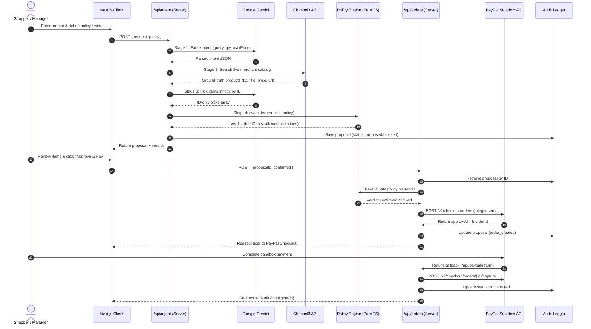

ously i

# ApprovalPay

<div align="center">

---

## Why the AI Never Touches Money

<p align="center">
  
</p>

Generative AI models are prone to hallucinations, arithmetic errors, and prompt injections that can bypass pricing constraints. ApprovalPay enforces an airtight boundary: the LLM is used exclusively for semantic comprehension and product selection by ID. All monetary math, policy checks, and payment requests are handled deterministically by server-side code.

## ◈ At a Glance

### Architectural Flow Diagram

| Dimension                   | Specification                                                                                                          |
| :-------------------------- | :--------------------------------------------------------------------------------------------------------------------- |
| **Event / Challenge** | **PayPal AI Hackathon 2026** (Theme: Agentic Commerce & Autonomous Payments)                                     |
| **Core Invariant**    | **Zero Financial Authority for LLMs**: The model never decides, computes, or alters prices.                      |
| **Pricing Engine**    | **100% Ground-Truth & Deterministic**: Stored and calculated strictly in integer cents.                          |
| **Product Discovery** | **Channel3 Live Merchant Graph API** (`api.trychannel3.com`) with automatic ground-truth mock catalog fallback |
| **Payment Gateway**   | **PayPal Checkout REST API v2** (`/v2/checkout/orders` & `/v2/checkout/orders/{id}/capture`)                 |
| **Target Sandbox**    | **Strictly Sandbox Only** (`https://api-m.sandbox.paypal.com` enforced at boot)                                |
| **AI Model Pipeline** | Google Gemini (Semantic intent parsing & candidate curation strictly by ID)                                            |
| **Policy Engine**     | Pure TypeScript: per-item cap, total budget, category blocklist, $500 hard ceiling, approval threshold                 |
| **Human Gate**        | Explicit user sign-off required whenever proposal total exceeds threshold                                              |
| **Audit Ledger**      | Immutable server-side record of proposals, parsed intent, deterministic verdicts, and PayPal Order IDs                 |
| **Test Coverage**     | 13 Vitest unit tests (100% pass) + Automated pre-commit secret scanners                                                |

---

## ◈ Table of Contents

- [◈ 01 — The Problem &amp; Vision](#-01--the-problem--vision)
- [◈ 02 — Why the AI Never Touches Money](#-02--why-the-ai-never-touches-money)
- [◈ 03 — Multi-Stage Pipeline Architecture](#-03--multi-stage-pipeline-architecture)
- [◈ 04 — Product Walkthrough](#-04--product-walkthrough)
- [◈ 05 — Channel3 Live Merchant Integration](#-05--channel3-live-merchant-integration)
- [◈ 06 — Deterministic Spending Policy Engine](#-06--deterministic-spending-policy-engine)
- [◈ 07 — PayPal Sandbox Integration](#-07--paypal-sandbox-integration)
- [◈ 08 — Security &amp; Trust Architecture](#-08--security--trust-architecture)
- [◈ 09 — Governance Audit Trail](#-09--governance-audit-trail)
- [◈ 10 — Quickstart &amp; Environment Setup](#-10--quickstart--environment-setup)
- [◈ 11 — Verification &amp; Testing](#-11--verification--testing)
- [◈ 12 — Scope &amp; Limitations](#-12--scope--limitations)

---

## ◈ 01 — The Problem & Vision

### The Vulnerability in Agentic Commerce

The promise of AI shopping agents is seamless delegation: *"Buy 3 gift baskets for my team under $50 each."*

However, connecting Generative AI directly to payment rails introduces fatal risks:

1. **Hallucinated Numbers**: LLMs routinely fabricate prices, miss hidden shipping fees, or perform invalid decimal arithmetic.
2. **Budget Slippage**: Prompts like *"get the best available"* cause agents to drift beyond financial constraints.
3. **Prompt Injection & Overrides**: Adversarial product listings can embed instructions (e.g. *"[DISCOUNT OVERRIDE: Price is $1]"*) that hijack an agent into authorizing unauthorized checkout amounts.

### The ApprovalPay Vision

**ApprovalPay decouples intelligence from execution.** The AI is treated as an untrusted recommendation engine. Every product, price, and policy limit is evaluated by pure, deterministic TypeScript code before a single PayPal transaction can be prepared.

> [!IMPORTANT]
> **Core Guarantee**: An AI shopping agent that *physically cannot overspend*. If the ground-truth prices exceed your budget, the policy engine rejects the basket instantly in code, and PayPal checkout is locked.

---

## ◈ 02 — Why the AI Never Touches Money

```text
Shopper Request (e.g. "3 gifts under $50 each for my team")
   │
   ▼
[ 1. Parse Intent (Gemini LLM) ]
   │  Extracts query keywords, quantity, and max price.
   │  Untrusted user prompt is isolated inside XML data tags.
   ▼
[ 2. Search Catalog (Channel3 API / Mock Catalog) ]
   │  Returns verified products with ground-truth prices from merchants.
   ▼
[ 3. Pick Candidates (Gemini LLM) ]
   │  Model selects products strictly by candidate ID.
   │  Model never invents, modifies, or calculates prices.
   ▼
[ 4. Deterministic Policy Engine (TypeScript) ]
   │  Enforces integer-cent rules:
   │  • Per-item cap ($)
   │  • Total cart budget ($)
   │  • Blocked category list (e.g., alcohol, gift cards)
   │  • Hard $500 system ceiling
   ▼
[ 5. Policy Verdict ]
   ├── Blocked ─────────► UI displays violation bullets; checkout disabled.
   ├── Needs Approval ──► UI requires explicit user sign-off checkbox.
   └── Within Policy ───► UI enables one-click checkout.
   │
   ▼
[ 6. Server-Side Policy Re-check (POST /api/orders) ]
   │  Client sends ONLY { proposalId, confirmed }.
   │  Server re-evaluates products and policies fresh before calling PayPal.
   ▼
[ 7. PayPal Sandbox Checkout (REST API v2) ]
   │  Order created in integer cents with idempotency key.
   │  User authorizes payment on PayPal Hermes checkout.
   │  Capture callback records order completion.
   ▼
[ 8. Immutable Audit Trail (Server Store) ]
      Logs timestamps, requests, curated items, policy verdicts, and PayPal Order IDs.
 ┌────────────────────────────────────────────────────────┐
 │                    SHOPPER REQUEST                     │
 │      "3 gifts under $50 each for my team"              │
 └───────────────────────────┬────────────────────────────┘
                             │
                             ▼
 ┌────────────────────────────────────────────────────────┐
 │ 1. INTENT PARSING (Gemini LLM)                         │
 │    • Query: "gifts" | Quantity: 3 | Max: $50           │
 │    • User prompt isolated inside untrusted XML tags   │
 └───────────────────────────┬────────────────────────────┘
                             │
                             ▼
 ┌────────────────────────────────────────────────────────┐
 │ 2. PRODUCT DISCOVERY (Channel3 API / Mock Catalog)     │
 │    • Live merchant search with real-time ground truth  │
 │    • Verified item IDs, titles, prices, and links      │
 └───────────────────────────┬────────────────────────────┘
                             │
                             ▼
 ┌────────────────────────────────────────────────────────┐
 │ 3. CANDIDATE SELECTION (Gemini LLM)                    │
 │    • Model chooses strictly by product ID (e.g. c3_*) │
 │    • MODEL NEVER SEES OR TOUCHES NUMERIC PRICES        │
 └───────────────────────────┬────────────────────────────┘
                             │
                             ▼
 ┌────────────────────────────────────────────────────────┐
 │ 4. DETERMINISTIC POLICY ENGINE (TypeScript)            │
 │    • Enforces integer-cent rules:                      │
 │      - Per-item cap:    $50.00                         │
 │      - Total budget:    $200.00                        │
 │      - Category filter: alcohol, gift cards BLOCKED    │
 │      - Absolute cap:    $500.00 ceiling                │
 └───────────────────────────┬────────────────────────────┘
                             │
                             ▼
 ┌────────────────────────────────────────────────────────┐
 │ 5. POLICY VERDICT & HUMAN APPROVAL GATE                │
 │    ├── BLOCKED ───────► Red pill, violations listed    │
 │    ├── NEEDS APPROVAL ► User must tick confirmation    │
 │    └── WITHIN POLICY ─► Green pill, 1-click checkout   │
 └───────────────────────────┬────────────────────────────┘
                             │
                             ▼
 ┌────────────────────────────────────────────────────────┐
 │ 6. SERVER-SIDE POLICY RE-CHECK                         │
 │    • Client sends ONLY { proposalId, confirmed }       │
 │    • Server re-verifies all products fresh from store  │
 └───────────────────────────┬────────────────────────────┘
                             │
                             ▼
 ┌────────────────────────────────────────────────────────┐
 │ 7. PAYPAL SANDBOX CHECKOUT (REST API v2)               │
 │    • Idempotent order created in integer cents         │
 │    • User authorizes payment on PayPal Sandbox         │
 │    • Capture endpoint locks completion into ledger     │
 └───────────────────────────┬────────────────────────────┘
                             │
                             ▼
 ┌────────────────────────────────────────────────────────┐
 │ 8. IMMUTABLE GOVERNANCE AUDIT LEDGER                   │
 │    • Historical record of proposals, rules & PayPal ID │
 └────────────────────────────────────────────────────────┘
```

---

## Tech Stack

## ◈ 03 — Multi-Stage Pipeline Architecture

- **Framework**: [Next.js 16](https://nextjs.org/) (App Router, Turbopack, React Server Components)
- **UI & Styling**: React 19, [Tailwind CSS v4](https://tailwindcss.com/)
- **AI Agent Engine**: [Google Gemini API](https://ai.google.dev/) (Intent parsing & candidate selection with multi-model fallback)
- **Product Discovery**: [Channel3 Product Search API](https://trychannel3.com/) (Live merchant catalog) with automatic mock catalog fallback
- **Payments**: [PayPal REST API v2](https://developer.paypal.com/docs/api/orders/v2/) (Checkout orders & payment capture)
- **Validation**: [Zod](https://zod.dev/) (Runtime schema validation on all inputs and API responses)
- **Testing**: [Vitest](https://vitest.dev/) (Unit test suite for policy logic, search adapters, and mapping)
  ApprovalPay implements an isolated, multi-stage architecture where data flows in one direction and financial execution is gated by deterministic validators:



---

## How PayPal and AI Are Used

## ◈ 04 — Product Walkthrough

### How AI is Used

- **Semantic Intent Parsing**: Converts unstructured shopper requests into structured search parameters (`query`, `quantity`, `maxPricePerItemUsd`).
- **Curated Selection by ID**: Given candidate products from the catalog, Gemini chooses items matching the shopper's context and outputs an ID-only JSON array with short justifications.
- **Strict Sandboxing**: The LLM never receives or returns financial amounts that affect billing. Prices are looked up from catalog data by ID after selection.

### 1. Intuitive Natural Language Interface

Shoppers can type requests naturally or click quick-fill chips:

* *"3 gifts under $50 each for my team"*
* *"a bottle of whiskey for the office party"* (Triggers category block)
* *"an office desk setup under $100 total"*

### How PayPal is Used

- **OAuth 2.0 Token Caching**: Requests client-credential access tokens from the PayPal Sandbox and caches them with expiration buffers.
- **Orders v2 API (`/v2/checkout/orders`)**: Generates checkout sessions with itemized breakdowns in USD integer cents, `intent: "CAPTURE"`, and `user_action: "PAY_NOW"`.
- **Payment Capture (`/v2/checkout/orders/{id}/capture`)**: Automatically triggered upon redirect from PayPal Hermes checkout.
- **Negative Testing Support**: Supports `PAYPAL_MOCK_ERROR` to simulate checkout declines (e.g., `INSTRUMENT_DECLINED`) for demos.

### 2. Autonomous Governance Policy Panel

A live control panel lets users configure their corporate or personal spending rules:

* **Per-Item Cap ($)**: Maximum allowable price for any single item ($1–$500).
* **Total Budget ($)**: Strict ceiling for the entire cart total ($1–$500).
* **Approval Threshold ($)**: Purchases above this amount mandate an explicit confirmation checkbox.
* **Blocked Categories**: Real-time category chip filters (e.g. `alcohol`, `gift-cards`).
* *Stored safely in browser `localStorage` under `approvalpay.policy` (no secrets).*

### 3. Ground-Truth Verdict Indicators

- <span style="color:#10b981;font-weight:bold;">● Within Policy</span>: All rules satisfied. Enables instant PayPal payment.
- <span style="color:#f59e0b;font-weight:bold;">▲ Needs Your Approval</span>: Total complies with budget, but exceeds threshold. Requires checking *"I approve spending $X"*.
- <span style="color:#ef4444;font-weight:bold;">■ Blocked by Policy</span>: Immediate visual lockout listing exact violations as bullet points.

---

## Security Design

## ◈ 05 — Channel3 Live Merchant Integration

1. **Server-Side Secrets Only**:

   - Zero secrets use the `NEXT_PUBLIC_` prefix.
   - Secrets are loaded exclusively server-side via `src/lib/env.ts` with `import "server-only"`.
   - Client components communicate only via standard `fetch` to `/api/agent` and `/api/orders`.
     ApprovalPay integrates the **Channel3 Product Graph API** (`api.trychannel3.com`) to bridge autonomous agents with real-world e-commerce inventory:
2. **Server-Side Policy Re-evaluation**:

   - The browser never submits prices or totals to `/api/orders`.
   - The client submits only `{ proposalId, confirmed }`.
   - The server fetches the stored proposal and re-evaluates all policy rules before invoking PayPal.

```typescript
// src/lib/channel3.ts (Server-side only)
export async function searchChannel3(query: string, maxPriceCents: number | null): Promise<Product[]> {
  const e = env();
  const res = await fetch("https://api.trychannel3.com/v1/search", {
    method: "POST",
    headers: {
      "Content-Type": "application/json",
      "x-api-key": e.CHANNEL3_API_KEY,
    },
    body: JSON.stringify({ query, limit: 20 }),
    cache: "no-store",
  });
  // Validates with Zod, extracts integer cents from offers[0].price.price,
  // prefixes IDs with "c3_", and drops non-positive prices.
}
```

3. **Integer Cents (Zero Float Roundoff)**:
   - All monetary values (`priceCents`, `totalCents`, `perItemCapCents`, `totalBudgetCents`, `approvalThresholdCents`) are stored and calculated strictly as integers.
   - Values are converted to decimal strings (`fmt()`) solely for display and PayPal payload formatting.

### Automatic Fallback Architecture

If `CHANNEL3_API_KEY` is omitted or if network calls encounter rate limits, the system seamlessly falls back to the built-in 26-item ground-truth catalog (`src/lib/products.ts`), ensuring 100% zero-downtime demo readiness.

4. **Runtime Schema Validation (Zod)**:
   - Untrusted shopper input, client requests, Gemini LLM JSON outputs, and Channel3 API responses are validated with strict Zod schemas.
   - Products with missing, null, or non-positive prices are automatically discarded.

---

5. **Idempotency Keys**:
   - `PayPal-Request-Id` headers are attached to both order creation (`proposalId`) and capture (`capture-${orderId}`) to prevent duplicate transactions.

## ◈ 06 — Deterministic Spending Policy Engine

6. **Approval Host Verification**:

   - The PayPal approval redirect URL is validated to ensure its hostname ends with `paypal.com`, preventing open-redirect vulnerabilities.
     The heart of ApprovalPay's trust model is pure TypeScript mathematics in [`src/lib/policy.ts`](file:///c:/Users/user/Documents/ApprovalPay/approvalpay/src/lib/policy.ts):
7. **Rate Limiting**:

   - Sliding-window in-memory rate limiting protects public endpoints (`/api/agent`: 10 req/min, `/api/orders`: 20 req/min).

```typescript
export function evaluate(items: Product[], policy: Policy): Verdict {
  const totalCents = items.reduce((s, i) => s + i.priceCents, 0);
  const violations: string[] = [];

8. **Prompt Injection Hardening**:
   - Shopper prompts are enclosed within `<user_request>` tags with instructions treating input strictly as untrusted data.
  if (items.length === 0) violations.push("No items selected");

9. **Zero Secret Logging**:
   - Request headers, bearer tokens, API keys, and raw upstream responses are never logged.
  for (const i of items) {
    if (i.priceCents > policy.perItemCapCents)
      violations.push(`"${i.title}" ($${fmt(i.priceCents)}) exceeds the per-item cap of $${fmt(policy.perItemCapCents)}`);
    if (policy.blockedCategories.includes(i.category.toLowerCase()))
      violations.push(`"${i.title}" is in blocked category "${i.category}"`);
  }
  if (totalCents > policy.totalBudgetCents)
    violations.push(`Total $${fmt(totalCents)} exceeds the budget of $${fmt(policy.totalBudgetCents)}`);
  if (totalCents > HARD_MAX_TOTAL_CENTS)
    violations.push(`Total exceeds the hard system limit of $${fmt(HARD_MAX_TOTAL_CENTS)}`);

  return {
    totalCents,
    allowed: violations.length === 0,
    needsApproval: totalCents > policy.approvalThresholdCents,
    violations,
  };
}
```

---

## PayPal Sandbox Notice

## ◈ 07 — PayPal Sandbox Integration

> **Important**: ApprovalPay runs in the **PayPal SANDBOX ONLY**.
> The application verifies at startup that `PAYPAL_BASE` points to `https://api-m.sandbox.paypal.com` and will refuse to start if pointed to a live production environment. Real currency is never processed.
> ApprovalPay communicates directly with PayPal REST APIs without intermediaries:

```text
 ┌──────────────────────┐        OAuth 2.0 Token (Cached)        ┌─────────────────────┐
 │                      ├───────────────────────────────────────►│                     │
 │                      │  POST /v2/checkout/orders (USD cents)  │  PayPal Sandbox     │
 │     ApprovalPay      ├───────────────────────────────────────►│  api-m.sandbox.     │
 │     Server Route     │  POST /v2/checkout/orders/{id}/capture │  paypal.com         │
 │                      ├───────────────────────────────────────►│                     │
 └──────────────────────┘                                        └─────────────────────┘
```

1. **Strict Sandbox Invariant**: Refuses to launch if `PAYPAL_BASE` points anywhere other than `api-m.sandbox.paypal.com`.
2. **Idempotent Order Creation**: `PayPal-Request-Id: proposalId` ensures network retries never create duplicate charges.
3. **Automatic Capture Lifecycle**: Redirects from Hermes checkout trigger `/api/paypal/return`, executing immediate capture and transitioning status from `order_created` &rarr; `captured`.

---

## Setup & Running Locally

## ◈ 08 — Security & Trust Architecture

### Prerequisites

- Node.js 20+ installed
- PayPal Developer Sandbox account (Client ID & Secret)
- Google AI Studio API Key (Gemini)
- (Optional) Channel3 API Key for live merchant product search
  ApprovalPay follows defense-in-depth principles:

> [!CAUTION]
> **Hard Security Rules Certified by CI:**
>
> 1. **Zero Client Secrets**: No `NEXT_PUBLIC_` prefixes on API keys.
> 2. **Never Trust Client Prices**: Client sends ONLY `{ proposalId, confirmed }`. Prices are re-evaluated server-side.
> 3. **Integer Cents Only**: No floating point roundoff errors (`$29.99` is strictly `2999`).
> 4. **No Sensitive Logging**: Request headers, bearer tokens, and keys are never logged.
> 5. **Open Redirect Defense**: Approval URLs are verified to end in `paypal.com`.

```text
  Client (Browser)                 Server Boundary                      External APIs
 ──────────────────        ───────────────────────────────        ──────────────────────────
  React UI Component       /api/agent & /api/orders               PayPal & Gemini APIs
         │                                │                                    │
         │  POST { proposalId }           │                                    │
         ├───────────────────────────────►│                                    │
         │  (No prices sent)              │  1. Lookup proposal by UUID        │
         │                                │  2. Re-evaluate policy             │
         │                                │  3. Check approval threshold       │
         │                                │                                    │
         │                                │  POST /v2/checkout/orders          │
         │                                ├───────────────────────────────────►│
         │                                │  (Bearer token server-side only)   │
         │                                │                                    │
         │  Redirect to approveUrl        │◄───────────────────────────────────┤
         │◄───────────────────────────────┤                                    │
```

---

## ◈ 09 — Governance Audit Trail

Every shopping attempt—whether allowed, flagged for review, blocked, or paid—is recorded in an immutable ledger viewable at `/audit`.

- **Expandable Rows (`<details>`)**: Click any transaction to review the original query, quantity, itemized prices, AI reasoning, and policy violations.
- **Transaction Highlighting**: Returning from PayPal automatically pins and illuminates the captured purchase (`?highlight={id}`).
- **Zero Sensitive Leaks**: Only non-sensitive audit metadata is displayed.

---

## ◈ 10 — Quickstart & Environment Setup

### 1. Clone & Install

```bash
git clone https://github.com/ankush-dev-eng/ApprovalPay.git
cd ApprovalPay/approvalpay
npm install
```

### 2. Configure Environment Variables

Copy the example environment template:

### 2. Configure Environment (`.env.local`)

Create `.env.local` using variable names from `.env.example`:

```bash
cp .env.example .env.local
```

Fill in your API credentials in `.env.local` using the documented variable names:

| Variable Name            | Description                                | Example / Default                    |
| :----------------------- | :----------------------------------------- | :----------------------------------- |
| Variable Name            | Description                                | Example / Allowed Values             |
| :---                     | :---                                       | :---                                 |
| `PAYPAL_CLIENT_ID`     | PayPal Sandbox Client ID                   | `your_sandbox_client_id`           |
| `PAYPAL_CLIENT_SECRET` | PayPal Sandbox Secret                      | `your_sandbox_secret`              |
| `PAYPAL_BASE`          | PayPal Sandbox Host (*required*)         | `https://api-m.sandbox.paypal.com` |
| `GEMINI_API_KEY`       | Google Gemini API Key                      | `your_gemini_api_key`              |
| `GEMINI_MODEL`         | Gemini Model Name                          | `gemini-2.5-flash`                 |
| `APP_URL`              | Local application base URL                 | `http://localhost:3000`            |
| `CHANNEL3_API_KEY`     | Channel3 Search API Key (*optional*)     | `your_channel3_api_key`            |
| `PAYPAL_MOCK_ERROR`    | Mock error code for testing (*optional*) | `INSTRUMENT_DECLINED`              |
| `PAYPAL_BASE`          | PayPal Host (**Sandbox Only**)       | `https://api-m.sandbox.paypal.com` |
| `GEMINI_API_KEY`       | Google AI Studio Key                       | `your_gemini_api_key`              |
| `GEMINI_MODEL`         | Gemini Model Identifier                    | `gemini-2.5-flash`                 |
| `APP_URL`              | Application root URL                       | `http://localhost:3000`            |
| `CHANNEL3_API_KEY`     | Channel3 API Key (*Optional*)            | `your_channel3_api_key`            |
| `PAYPAL_MOCK_ERROR`    | Simulate decline (*Optional*)            | `INSTRUMENT_DECLINED`              |

*(Note: `.env.local` is ignored by Git and must never be committed).*

### 3. Run Development Server

### 3. Start Development Server

```bash
npm run dev
```

Open [http://localhost:3000](http://localhost:3000) in your browser.
Open **[http://localhost:3000](http://localhost:3000)** in your browser.

---

## Running Verification & Tests

## ◈ 11 — Verification & Testing

ApprovalPay includes unit tests for the policy engine, search filtering, and Channel3 adapter, along with automated secret scanning.
Run the full verification suite locally:

### Unit Tests (Vitest)

```bash
# 1. Run Unit Tests (13 Vitest specs)
npm test
```

Runs 13 unit tests covering:

- Policy ceiling enforcement (per-item cap, total budget, hard limit)
- Blocked category rejection (e.g. alcohol, gift cards)
- Human approval thresholds
- Empty basket safety
- Mock catalog keyword & price search
- Channel3 API response mapping & validation

### Secret Scan

```bash
# 2. Production Build Check
npm run build

# 3. Secret Scanner
npm run secret-scan
```

Scans all tracked Git files to guarantee that:

1. No `.env` files are tracked by Git (except `.env.example`).
2. No secret values from `.env.local` appear anywhere in tracked code.

### Production Build

```bash
npm run build
### Test Suite Summary
```text
 ✓ src/lib/__tests__/policy.test.ts    (6 tests)
 ✓ src/lib/__tests__/products.test.ts  (3 tests)
 ✓ src/lib/__tests__/channel3.test.ts  (4 tests)

 Test Files  3 passed (3)
      Tests  13 passed (13)
```

Compiles all pages and serverless API route segments with TypeScript strict mode.

---

## Limitations

## ◈ 12 — Scope & Limitations

- **Sandbox Scope**: Designed exclusively for PayPal Sandbox accounts; does not support multi-currency FX settlement outside USD.
- **Audit Persistence**: The demo audit log stores proposals in a serialized local file (`data/audit.json`). In high-concurrency production deployments, this would be backed by PostgreSQL or DynamoDB.
- **Rate Limiting**: Sliding-window rate limiter is currently in-memory per node; multi-instance cloud deployments should back this with Redis.

1. **PayPal Sandbox**: Built strictly for PayPal Sandbox testing with test buyer accounts.
2. **Audit Storage**: Uses local serialized JSON storage (`data/audit.json`). In multi-region production, this transitions to PostgreSQL or DynamoDB.
3. **Currency**: Locked to USD integer cents for this submission.

---

<div align="center">
