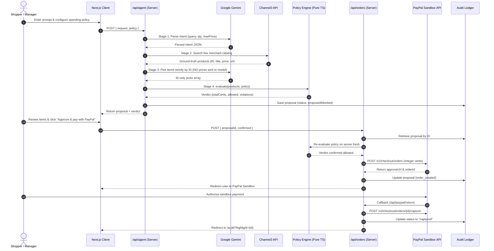
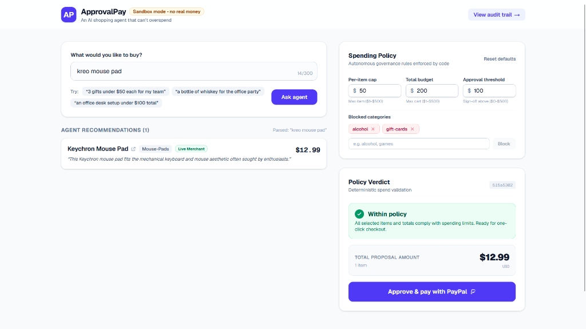
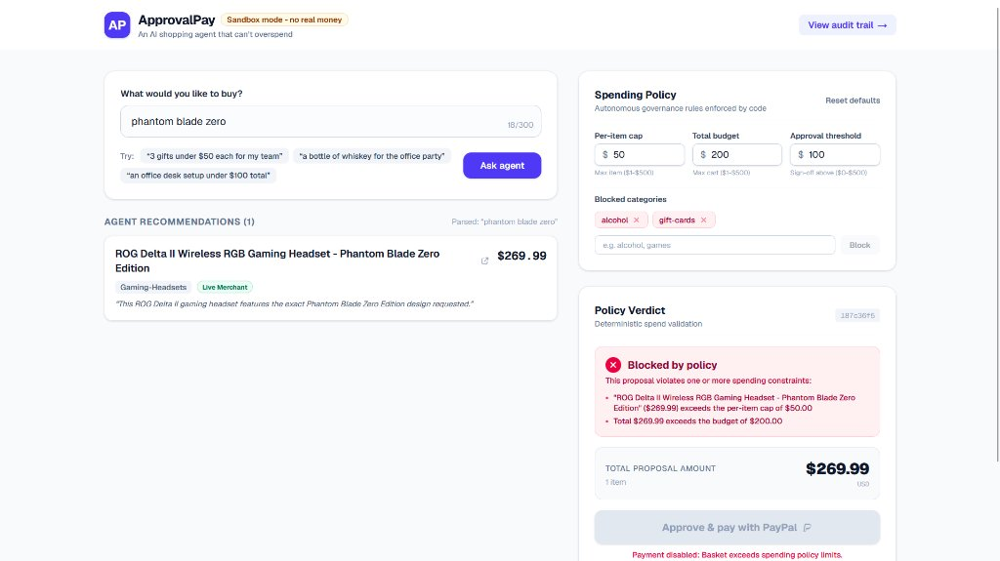
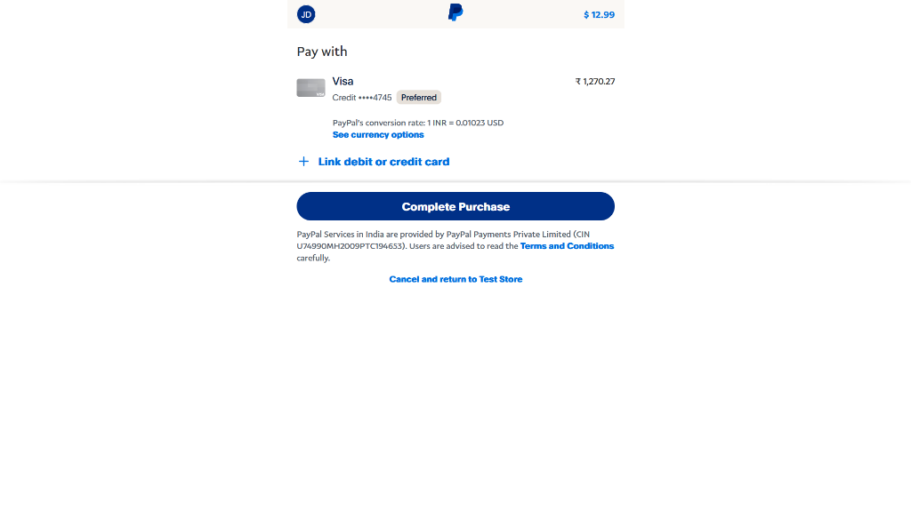

<div align="center">

<!-- Header Animated Wave Banner -->


<br/>

<!-- Animated Typing Tagline -->
<p align="center">
  
</p>

<!-- Project Badges -->
<p align="center">
  <a href="https://approvalpay.onrender.com/"></a>
  <a href="https://developer.paypal.com/docs/api/orders/v2/"></a>
  <a href="https://ai.google.dev/"></a>
  <a href="https://trychannel3.com"></a>
  <a href="https://nextjs.org"></a>
  <a href="https://www.typescriptlang.org"></a>
  <a href="https://tailwindcss.com"></a>
  <a href="https://vitest.dev"></a>
  <a href="LICENSE"></a>
</p>

<p align="center">
  <strong>Autonomous AI agent shopping governed by hard mathematical policy bounds.</strong><br>
  Built with pride for the <strong>PayPal AI Hackathon 2026</strong> &bull; <em>Category: Agentic Commerce</em><br>
  <strong>Developer</strong> &bull; Ankush Shahu
</p>

<p align="center">
  <a href="https://approvalpay.onrender.com/"><strong>🚀 Open Live Application</strong></a> &bull;
  <a href="https://approvalpay.onrender.com/audit"><strong>📋 View Governance Audit Trail</strong></a> &bull;
  <a href="https://github.com/ankush-dev-eng/ApprovalPay"><strong>📦 GitHub Repository</strong></a>
</p>

</div>

---

<p align="center">
  
</p>

## ◈ At a Glance

| Dimension | Specification |
|:---|:---|
| **Live Production App** | **[https://approvalpay.onrender.com](https://approvalpay.onrender.com)** |
| **Event / Challenge** | **PayPal AI Hackathon 2026** (Theme: Agentic Commerce & Autonomous Payments) |
| **Core Invariant** | **Zero Financial Authority for LLMs**: The model never sees, computes, or alters numeric prices. |
| **Pricing Engine** | **100% Deterministic (Integer Cents)**: Prices come strictly from verified catalog data post-selection. |
| **Product Discovery** | **Channel3 Live Merchant Graph API** (`api.trychannel3.com`) with automatic mock catalog fallback |
| **Payment Gateway** | **PayPal Checkout REST API v2** (`/v2/checkout/orders` & `/v2/checkout/orders/{id}/capture`) |
| **Target Sandbox** | **Strictly Sandbox Only** (`https://api-m.sandbox.paypal.com` enforced at startup) |
| **AI Model Pipeline** | Google Gemini (Semantic intent parsing & candidate curation strictly by ID) |
| **Policy Engine** | Pure TypeScript: per-item cap, total budget, category blocklist, $500 hard ceiling, approval threshold |
| **Human Gate** | Explicit user confirmation checkbox required whenever proposal total exceeds threshold |
| **Audit Ledger** | Server-side record of proposals, intent, policy verdicts, and PayPal Order IDs (`data/audit.json`) |
| **Automated Testing** | 26 Vitest unit tests (100% pass) + pre-commit secret scanners + GitHub Actions CI |

---

## ◈ Table of Contents

- [◈ 01 — The Problem & Vision](#-01--the-problem--vision)
- [◈ 02 — Why the AI Never Touches Money](#-02--why-the-ai-never-touches-money)
- [◈ 03 — Multi-Stage Pipeline Flowchart](#-03--multi-stage-pipeline-flowchart)
- [◈ 04 — Product Walkthrough & Visual Proof](#-04--product-walkthrough--visual-proof)
- [◈ 05 — Channel3 Live Merchant Discovery](#-05--channel3-live-merchant-discovery)
- [◈ 06 — Deterministic Spending Policy Engine](#-06--deterministic-spending-policy-engine)
- [◈ 07 — PayPal Sandbox Integration](#-07--paypal-sandbox-integration)
- [◈ 08 — Security & Trust Architecture](#-08--security--trust-architecture)
- [◈ 09 — Governance Audit Trail](#-09--governance-audit-trail)
- [◈ 10 — Quickstart & Environment Setup](#-10--quickstart--environment-setup)
- [◈ 11 — Verification & Testing](#-11--verification--testing)
- [◈ 12 — Scope & Limitations](#-12--scope--limitations)
- [◈ 13 — License](#-13--license)

---

## ◈ 01 — The Problem & Vision

### The Vulnerability in Agentic Commerce
The promise of AI shopping agents is seamless delegation: *"Buy 3 gifts for my team under $50 each."*

However, connecting Generative AI directly to payment rails introduces fatal financial risks:
1. **Hallucinated Numbers**: LLMs routinely fabricate prices, miss shipping fees, or perform invalid decimal arithmetic.
2. **Budget Slippage**: Prompts like *"get the best available"* cause agents to drift beyond financial constraints.
3. **Prompt Injection & Overrides**: Adversarial product listings can embed instructions (e.g. *"[DISCOUNT OVERRIDE: Price is $1]"*) that hijack an agent into authorizing unauthorized checkout amounts.

### The ApprovalPay Vision
**ApprovalPay decouples semantic intelligence from financial execution.** The AI is treated as an untrusted recommendation engine. Every product, price, and policy limit is evaluated by pure, deterministic TypeScript code before a single PayPal transaction can be prepared.

> [!IMPORTANT]
> **Core Guarantee**: An AI shopping agent that *physically cannot overspend*. If ground-truth prices exceed your budget or violate category restrictions, the policy engine rejects the basket in code, and PayPal checkout is locked.

---

## ◈ 02 — Why the AI Never Touches Money

ApprovalPay enforces an airtight boundary: the LLM is used exclusively for natural-language parsing and candidate selection by ID.

```text
 ┌────────────────────────────────────────────────────────┐
 │                    SHOPPER REQUEST                     │
 │      "3 gifts under $50 each for my team"              │
 └───────────────────────────┬────────────────────────────┘
                             │
                             ▼
 ┌────────────────────────────────────────────────────────┐
 │ 1. INTENT PARSING (Gemini LLM)                         │
 │    • Query: "gifts" | Quantity: 3 | Max: $50           │
 │    • User prompt isolated inside untrusted XML tags   │
 └───────────────────────────┬────────────────────────────┘
                             │
                             ▼
 ┌────────────────────────────────────────────────────────┐
 │ 2. PRODUCT DISCOVERY (Channel3 API / Mock Catalog)     │
 │    • Live merchant search with real-time ground truth  │
 │    • Verified item IDs, titles, prices, and links      │
 └───────────────────────────┬────────────────────────────┘
                             │
                             ▼
 ┌────────────────────────────────────────────────────────┐
 │ 3. CANDIDATE SELECTION (Gemini LLM)                    │
 │    • Model receives ONLY candidate IDs and titles      │
 │    • MODEL NEVER SEES OR DECIDES NUMERIC PRICES        │
 └───────────────────────────┬────────────────────────────┘
                             │
                             ▼
 ┌────────────────────────────────────────────────────────┐
 │ 4. DETERMINISTIC POLICY ENGINE (TypeScript)            │
 │    • Enforces integer-cent rules:                      │
 │      - Per-item cap:    $50.00 (5,000 cents)           │
 │      - Total budget:    $200.00 (20,000 cents)         │
 │      - Category filter: alcohol, gift cards BLOCKED    │
 │      - Absolute cap:    $500.00 ceiling                │
 └───────────────────────────┬────────────────────────────┘
                             │
                             ▼
 ┌────────────────────────────────────────────────────────┐
 │ 5. POLICY VERDICT & HUMAN APPROVAL GATE                │
 │    ├── BLOCKED ───────► Red pill, violations listed    │
 │    ├── NEEDS APPROVAL ► User must tick confirmation    │
 │    └── WITHIN POLICY ─► Green pill, 1-click checkout   │
 └───────────────────────────┬────────────────────────────┘
                             │
                             ▼
 ┌────────────────────────────────────────────────────────┐
 │ 6. SERVER-SIDE POLICY RE-CHECK                         │
 │    • Client sends ONLY { proposalId, confirmed }       │
 │    • Server re-verifies all products fresh from store  │
 └───────────────────────────┬────────────────────────────┘
                             │
                             ▼
 ┌────────────────────────────────────────────────────────┐
 │ 7. PAYPAL SANDBOX CHECKOUT (REST API v2)               │
 │    • Idempotent order created in integer cents         │
 │    • User authorizes payment on PayPal Sandbox         │
 │    • Capture endpoint locks completion into ledger     │
 └───────────────────────────┬────────────────────────────┘
                             │
                             ▼
 ┌────────────────────────────────────────────────────────┐
 │ 8. GOVERNANCE AUDIT LEDGER                             │
 │    • Server log of proposals, rules & PayPal Order ID  │
 └───────────────────────────┬────────────────────────────┘
```

---

## ◈ 03 — Multi-Stage Pipeline Flowchart

Data flows in one direction, and payment execution is strictly gated by server-side validators:



---

## ◈ 04 — Product Walkthrough & Visual Proof

### 1. Main Shopping Experience (Live Merchant Discovery)
Shoppers can enter natural language requests or click suggested chips. Live merchant items from Channel3 display a **"Live Merchant"** badge with direct links to merchant pages.

<p align="center">
  
</p>

### 2. Hard Policy Lockout (Blocked State)
When a requested item violates category restrictions (e.g. alcohol) or exceeds the per-item cap, the policy engine locks checkout with bulleted violation notices.

<p align="center">
  
</p>

### 3. PayPal Sandbox Checkout
Seamless redirect to PayPal Sandbox with itemized breakdowns in exact USD integer cents.

<p align="center">
  
</p>

### 4. Governance Audit Trail
Every proposal, verdict, and PayPal capture ID is logged in an expandable audit trail with highlighting for completed transactions.

<p align="center">
  
</p>

---

## ◈ 05 — Channel3 Live Merchant Discovery

ApprovalPay integrates the **Channel3 Product Graph API** (`api.trychannel3.com`) to bridge autonomous agents with real-world e-commerce inventory:

```typescript
// src/lib/channel3.ts (Server-side only)
export async function searchChannel3(query: string, maxPriceCents: number | null): Promise<Product[]> {
  const e = env();
  const res = await fetch("https://api.trychannel3.com/v1/search", {
    method: "POST",
    headers: {
      "Content-Type": "application/json",
      "x-api-key": e.CHANNEL3_API_KEY,
    },
    body: JSON.stringify({ query, limit: 20 }),
    cache: "no-store",
  });
  // Validates with Zod, extracts integer cents from offers[0].price.price,
  // prefixes IDs with "c3_", and drops non-positive prices.
}
```

### Graceful Fallback Architecture
If `CHANNEL3_API_KEY` is omitted or if network calls encounter rate limits, the system seamlessly falls back to the built-in 26-item ground-truth catalog (`src/lib/products.ts`), ensuring reliable demo readiness under all conditions.

---

## ◈ 06 — Deterministic Spending Policy Engine

The heart of ApprovalPay's trust model is pure TypeScript mathematics in [`src/lib/policy.ts`](file:///c:/Users/user/Documents/ApprovalPay/approvalpay/src/lib/policy.ts):

```typescript
export function evaluate(items: Product[], policy: Policy): Verdict {
  const totalCents = items.reduce((s, i) => s + i.priceCents, 0);
  const violations: string[] = [];

  if (items.length === 0) violations.push("No items selected");

  for (const i of items) {
    if (i.priceCents > policy.perItemCapCents)
      violations.push(`"${i.title}" ($${fmt(i.priceCents)}) exceeds the per-item cap of $${fmt(policy.perItemCapCents)}`);
    if (policy.blockedCategories.includes(i.category.toLowerCase()))
      violations.push(`"${i.title}" is in blocked category "${i.category}"`);
  }
  if (totalCents > policy.totalBudgetCents)
    violations.push(`Total $${fmt(totalCents)} exceeds the budget of $${fmt(policy.totalBudgetCents)}`);
  if (totalCents > HARD_MAX_TOTAL_CENTS)
    violations.push(`Total exceeds the hard system limit of $${fmt(HARD_MAX_TOTAL_CENTS)}`);

  return {
    totalCents,
    allowed: violations.length === 0,
    needsApproval: totalCents > policy.approvalThresholdCents,
    violations,
  };
}
```

---

## ◈ 07 — PayPal Sandbox Integration

ApprovalPay communicates directly with PayPal REST APIs without intermediaries:

1. **Strict Sandbox Invariant**: Refuses to launch if `PAYPAL_BASE` points anywhere other than `api-m.sandbox.paypal.com`.
2. **Idempotent Order Creation**: `PayPal-Request-Id: proposalId` ensures network retries never create duplicate charges.
3. **Automatic Capture Lifecycle**: Redirects from Hermes checkout trigger `/api/paypal/return`, executing immediate capture and transitioning status from `order_created` &rarr; `captured`.

---

## ◈ 08 — Security & Trust Architecture

ApprovalPay enforces strict defense-in-depth principles:

> [!CAUTION]
> **Hard Security Rules Enforced in Code:**
> 1. **Zero Client Secrets**: No `NEXT_PUBLIC_` prefixes on API keys. Secrets reside in `src/lib/env.ts` with `import "server-only"`.
> 2. **Never Trust Client Prices**: The browser sends ONLY `{ proposalId, confirmed }`. Prices are re-evaluated server-side.
> 3. **Integer Cents Only**: No floating point roundoff errors (`$29.99` is strictly `2999`).
> 4. **No Sensitive Logging**: Request headers, bearer tokens, and keys are never logged.
> 5. **Open Redirect Defense**: Approval URLs are verified to end in `paypal.com`.

---

## ◈ 09 — Governance Audit Trail

Every shopping proposal—whether allowed, flagged for review, blocked, or paid—is recorded in an audit ledger viewable at `/audit`.

- **Expandable Rows (`<details>`)**: Review original intent, quantity, itemized prices, AI reasoning, and policy violations.
- **Transaction Highlighting**: Returning from PayPal automatically pins and illuminates the captured purchase (`?highlight={id}`).
- **Note on Storage**: Stored locally in `data/audit.json`. On Render's Free tier, the filesystem is ephemeral and resets on cold starts.

---

## ◈ 10 — Quickstart & Environment Setup

### 1. Clone & Install
```bash
git clone https://github.com/ankush-dev-eng/ApprovalPay.git
cd ApprovalPay
npm install
```

### 2. Configure Environment (`.env.local`)
Create `.env.local` using variable names from `.env.example`:

```bash
cp .env.example .env.local
```

| Variable Name | Description | Example / Allowed Values |
|:---|:---|:---|
| `PAYPAL_CLIENT_ID` | PayPal Sandbox Client ID | `your_sandbox_client_id` |
| `PAYPAL_CLIENT_SECRET` | PayPal Sandbox Secret | `your_sandbox_secret` |
| `PAYPAL_BASE` | PayPal Host (**Sandbox Only**) | `https://api-m.sandbox.paypal.com` |
| `GEMINI_API_KEY` | Google AI Studio Key | `your_gemini_api_key` |
| `GEMINI_MODEL` | Gemini Model Identifier | `gemini-2.5-flash` |
| `APP_URL` | Application root URL | `http://localhost:3000` |
| `CHANNEL3_API_KEY` | Channel3 API Key (*Optional*) | `your_channel3_api_key` |
| `PAYPAL_MOCK_ERROR` | Simulate decline (*Optional*) | `INSTRUMENT_DECLINED` |

*(Note: `.env.local` is ignored by Git and must never be committed).*

### 3. Start Development Server
```bash
npm run dev
```
Open **[http://localhost:3000](http://localhost:3000)** in your browser.

---

## ◈ 11 — Verification & Testing

Run the full verification suite locally:

```bash
# 1. Run Unit Tests (13 Vitest specs)
npm test

# 2. Production Build Check
npm run build

# 3. Secret Scanner
npm run secret-scan
```

### Test Suite Summary
```text
 ✓ src/lib/__tests__/policy.test.ts    (11 tests)
 ✓ src/lib/__tests__/channel3.test.ts  (6 tests)
 ✓ src/lib/__tests__/products.test.ts  (3 tests)
 ✓ src/lib/__tests__/agent.test.ts     (3 tests)
 ✓ src/lib/__tests__/orders.test.ts    (3 tests)

 Test Files  5 passed (5)
      Tests  26 passed (26)
```

---

## ◈ 12 — Scope & Limitations

1. **PayPal Sandbox**: Built strictly for PayPal Sandbox testing with test buyer accounts. Real currency is never processed.
2. **Ephemeral Audit Storage**: Uses local serialized JSON storage (`data/audit.json`). On Render's free tier, the container disk resets on sleep. In production, this would be backed by PostgreSQL or DynamoDB.
3. **Currency**: Single-currency USD integer cents for this submission.

---

## ◈ 13 — License

Distributed under the **MIT License**. See [`LICENSE`](LICENSE) for complete terms.

<div align="center">

<p align="center">
  
</p>

<br/>

### ApprovalPay

**ZERO FINANCIAL LEAKS • DETERMINISTIC AI COMMERCE • PAYPAL SANDBOX**

<br/>


</div>
