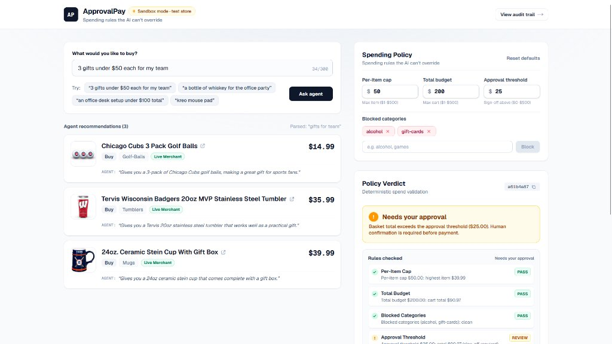
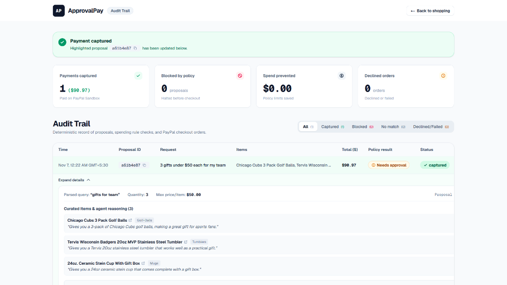
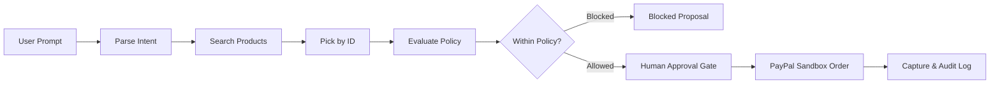

# ApprovalPay

An AI shopping agent governed by deterministic spending policy code, ensuring zero financial authority for language models before PayPal checkout.

Live Application: https://approvalpay.onrender.com

## Screenshots

| Shopping & Policy Evaluation | Audit Trail & Ledger |
|---|---|
|  |  |

## How It Works

The system enforces a strict one-way pipeline: parse -> search -> pick by ID -> policy -> human approval -> PayPal sandbox -> audit log.



1. **Parse**: Gemini extracts search keywords, desired quantity, and per-item budget constraints.
2. **Search**: Searches live merchants via Channel3 API (or local catalog fallback), filtering offers strictly to USD.
3. **Pick by ID**: Gemini selects candidates strictly by ID and title. The model never sees numeric prices. If no candidate matches a requested brand or product, it flags noGoodMatch.
4. **Policy**: Pure TypeScript policy engine checks per-item cap, total budget, $500 hard ceiling, approval threshold, and word-level blocked categories (title, category, tags).
5. **Human Approval**: If the basket total exceeds the approval threshold, checkout is locked until the user explicitly confirms the authorization checkbox.
6. **PayPal Sandbox**: Server generates an order with integer cents and redirects the user to PayPal Sandbox checkout.
7. **Audit Log**: The capture callback confirms payment and records the transaction with its PayPal Order ID in the server-side audit store.

## How AI Is Used

- Intent parsing: Extracts structured search parameters from untrusted user prompt text.
- Product selection: Selects candidate IDs that best fulfill the request without access to price fields.
- Relevance verification: Flags requests where catalog candidates do not match specific brand or model requirements.
- Zero financial decision-making: The LLM never calculates prices, checks totals, evaluates discounts, or authorizes payments.

## How PayPal Is Used

- PayPal Orders REST API v2 (`/v2/checkout/orders` and `/v2/checkout/orders/{id}/capture`).
- Runs strictly against the PayPal Sandbox (`api-m.sandbox.paypal.com`).
- Creates idempotent orders using proposal IDs as `PayPal-Request-Id`.
- Sets experience context `brand_name: "ApprovalPay"` and `user_action: "PAY_NOW"`.
- Executes server-side capture upon return callback and logs the order ID.

## Security Design

- **Server-Side Secrets**: All credentials are loaded exclusively in Node.js via `src/lib/env.ts` (`server-only`). No client components access secrets, and no secrets use `NEXT_PUBLIC_`.
- **Zod Validation**: All API bodies (`/api/agent`, `/api/orders`) and upstream responses are validated with strict Zod schemas.
- **Server Re-Evaluates Stored Basket**: Client sends only `{ proposalId, confirmed }`. The server retrieves the proposal from local storage and re-evaluates the stored basket against the policy before calling PayPal.
- **Integer Cents**: All monetary calculations use integer cents, preventing floating-point rounding errors.
- **Idempotency Keys**: Both order creation and order capture send unique idempotency keys to prevent duplicate transactions.
- **Rate Limiting**: In-memory sliding window rate limits protect both the agent and order endpoints.
- **Approval-Host Verification**: Redirect URLs returned by PayPal are verified to terminate on `paypal.com` before redirecting the client.
- **Proposal Expiry**: Proposals older than 15 minutes are rejected (`409 Conflict`), preventing checkout on stale baskets.

## Setup

Clone the repository and install dependencies:

```bash
git clone https://github.com/ankush-dev-eng/ApprovalPay.git
cd ApprovalPay
npm install
```

Copy the example environment configuration:

```bash
cp .env.example .env.local
```

Configure required environment variables in `.env.local` (reference names only, never commit values):

- `PAYPAL_CLIENT_ID`
- `PAYPAL_CLIENT_SECRET`
- `PAYPAL_BASE` (must be `https://api-m.sandbox.paypal.com`)
- `GEMINI_API_KEY`
- `GEMINI_MODEL`
- `APP_URL`
- `CHANNEL3_API_KEY` (optional)
- `PAYPAL_MOCK_ERROR` (optional)

Start the local server:

```bash
npm run dev
```

Open `http://localhost:3000` in your browser.

## Tests

The project includes 30 Vitest tests covering deterministic spending policies, word-level category blocking, Channel3 USD currency filtering, Channel3 HTTPS image mapping, proposal expiry, and selection relevance guards:

```bash
npm test
```

Build verification and secret scanning:

```bash
npm run build
npm run secret-scan
```

## Limitations

- **Sandbox Only**: Runs strictly on PayPal Sandbox; real currency is never processed.
- **Ephemeral Audit Storage**: The audit trail is saved to a local file (`data/audit.json`), which resets when Render's free tier container sleeps.
- **Client Policy Configuration**: Spending policy parameters are set in the browser UI for demonstration; an enterprise deployment would enforce policies server-side per organization or role.
- **Shipping & Tax Excluded**: Item totals evaluate catalog prices only; shipping and sales taxes are excluded from policy caps.
- **Sandbox Store Recipient**: Checkout pays the configured sandbox test store, not the third-party merchant.
